# Does evolution favour optimistic learners in social dilemmas?

A replication and extension of Hoxha, Sperber & Palminteri (2025, *PNAS*) from individual
learning to the Iterated Prisoner's Dilemma.

## Question
Reinforcement learners often show a **positivity (optimism) bias**: they learn more from
positive than from negative prediction errors (α⁺ > α⁻; Lefebvre et al., 2017).
Hoxha, Sperber & Palminteri (2025) used evolutionary simulations to show that this bias can be
**adaptive** when agents learn alone in bandit tasks.

**Does the same hold when agents learn *against each other*, in a social dilemma?** Here "bad news"
often means a partner defected. I evolve learning biases in populations of agents playing the
Iterated Prisoner's Dilemma (IPD), compare the result with the individual case, and test what
drives it: the payoffs of the game, or the fact that partners are themselves learners.

## Main results (preliminary)

**In short:**
- Optimism evolves in the IPD as well as in the bandit task, as long as the temptation to defect
  is high.
- Which bias evolves is decided by the **payoff structure**. Optimism favours the action with the
  wider range of outcomes, and temptation decides whether that is defecting or cooperating.
- The partners **do not need to be learners**: a non-learning, non-responsive partner gives the
  same pattern. A **responsive** partner (tit-for-tat) changes it.
- The direction of the effects is robust; their size is not. They shrink markedly under gentler,
  fitness-proportional selection, and the low-temptation pessimism is fragile.

### 1. Replication
When agents learn alone (2-armed bandit, myopic), an **optimism bias evolves** (optimism index
+0.56 ± 0.02; α⁺ ≈ 0.60, α⁻ ≈ 0.17), consistent with Hoxha et al. (2025). It holds for every
starting value tested (+0.31 to +0.56) and is strongest when starting values are neutral.

### 2. Extension: optimism also evolves in the Iterated Prisoner's Dilemma
I compare agents with the same farsightedness (γ = 0.9), learning either a bandit or against other
learners in the IPD:
- **In the IPD, optimism evolves more strongly than in the bandit:** +0.80 ± 0.01 vs +0.27 ± 0.06
  (noise 0.05, T = 5). This is driven mainly by a very low learning rate for negative prediction
  errors (α⁻ ≈ 0.10, α⁺ ≈ 0.82).
- **It is also more robust.** In the IPD it holds for every starting value tested (+0.71 to +0.82).
  In the farsighted bandit it disappears when agents start out over-expecting.
- **This is not because the partners learn.** The two tasks also differ in their payoff
  distributions, state structure and non-stationarity. Section 7 shows that a non-learning partner
  with the same payoffs gives the same result, so the difference comes from the payoff structure.
- **Myopic agents (γ = 0) in the IPD stay close to neutral** (+0.16 ± 0.09; α⁺ ≈ 0.76,
  α⁻ ≈ 0.68). This is expected: defection pays more than cooperation whatever the partner does,
  so the learning bias barely changes behaviour.

<p align="center">
  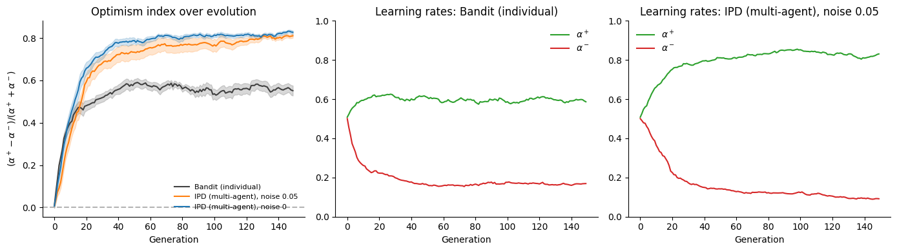<br>
  <sub><b>Figure 1.</b> Optimism index over 150 generations (left) and evolved learning rates for agents learning alone (middle) and against each other in the IPD (right). Mean ± SE over 20 runs.</sub>
</p>

<p align="center">
  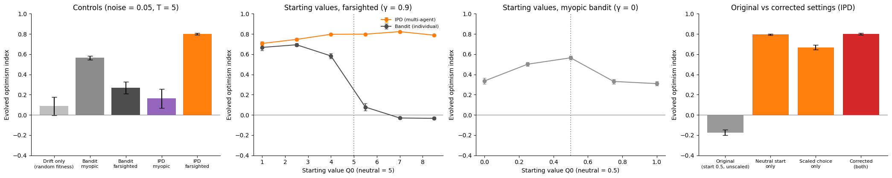<br>
  <sub><b>Figure 2.</b> Controls (noise 0.05, T = 5): neutral drift, myopic vs farsighted agents in the bandit and the IPD; sensitivity to starting values (farsighted agents and myopic bandit); original vs corrected settings.</sub>
</p>

### 3. The temptation to defect matters
- **High temptation (T ≥ 5):** optimism evolves at every noise level (+0.73 to +0.84).
- **Intermediate temptation (T = 4):** optimism weakens as noise rises (+0.57 → +0.17).
- **Low temptation (T = 3.5):** optimism disappears, and a **pessimism bias** grows with noise
  (+0.06 without noise → −0.18 at 10% → −0.26 ± 0.06 at 20%; α⁺ ≈ 0.46, α⁻ ≈ 0.73). At 20%
  noise it holds across starting values (−0.26 to −0.34).
- **The effect survives a fixed payoff scale.** With payoffs divided by a constant, T = 5 stays
  optimistic for every β tested (+0.47 to +0.85), while T = 3.5 is pessimistic for every β
  (−0.08 to −0.39). So the effect reflects the payoff structure, not a change in exploration.
- **The size of the pessimism depends on choice noise:** at 20% noise, −0.39 for decisive
  agents (β = 20) vs −0.08 for exploratory ones (β = 5).
- **Caveat: the low-temptation pessimism is fragile.** With much more decisive agents (β = 30 and
  100, under the default payoff scaling), it shrinks to −0.07 and −0.14 (section 7). The
  high-temptation optimism does not.

<p align="center">
  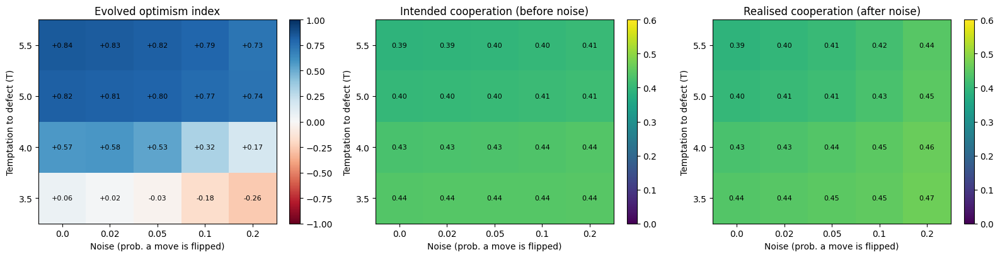<br>
  <sub><b>Figure 3.</b> Noise × temptation sweep: evolved optimism index (left), intended cooperation (middle) and realised cooperation after noise (right). 20 runs per cell.</sub>
</p>

<p align="center">
  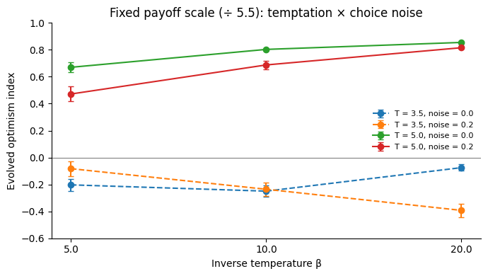<br>
  <sub><b>Figure 4.</b> With payoffs divided by a fixed constant, high temptation stays optimistic and low temptation pessimistic across choice noise (β).</sub>
</p>

### 4. Mechanism: optimism favours the riskier action, and temptation decides which action that is
- With asymmetric learning rates, values converge to an **expectile** of the outcomes at level
  τ = α⁺/(α⁺ + α⁻), not to the mean (Palminteri & Lebreton, 2022). I confirm this in simulation:
  an optimist values an option by its "good days" and so overvalues options with a large gap
  between their best and worst outcomes.

<p align="center">
  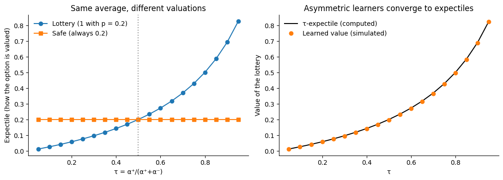<br>
  <sub><b>Figure 5.</b> Left: two options with the same average are valued differently depending on τ. Right: simulated asymmetric learners converge to the computed τ-expectile.</sub>
</p>

- In the IPD, which action has the larger gap depends on temptation:
  - cooperating ranges from S to R (gap R − S = 3);
  - defecting ranges from P to T (gap T − P = T − 1).
  - Defecting is the riskier action when T > 4, cooperating when T < 4. This matches the sweep:
    strong optimism for T ≥ 5, none or pessimism at T = 3.5, and intermediate values at T = 4.
- **Fitness landscapes.** Test agents with every τ played against the evolved populations:
  - At high temptation (T = 5), payoff rises steadily with τ and peaks at τ = 0.90, matching the
    residents (0.91). The evolved optimism is stable: no other bias does better.
  - At low temptation (T = 3.5, noise 0.20), the landscape is nearly flat. Strong optimism does
    worst, and the best τ is 0.25 (residents: 0.34). Selection against optimism is real but weak,
    which explains why this result depends on settings.

<p align="center">
  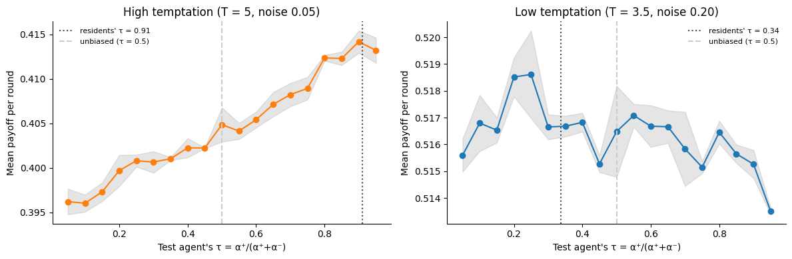<br>
  <sub><b>Figure 6.</b> Payoff of test agents with each τ against the evolved resident populations. Dotted line: residents' τ; dashed line: unbiased learner (τ = 0.5).</sub>
</p>

- **Behaviour.** Optimism pushes behaviour in opposite directions in the two worlds:
  - at high temptation, more optimistic agents defect more, exploiting cooperators;
  - at low temptation, they cooperate more and are exploited more often in a noisy world.

<p align="center">
  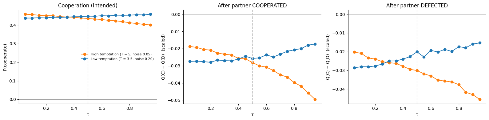<br>
  <sub><b>Figure 7.</b> Intended cooperation (left) and learned preference for cooperating over defecting after the partner cooperated (middle) or defected (right), by τ.</sub>
</p>

- **A direct test confirms that payoffs are enough.** A payoff-matched bandit (a partner who
  cooperates 40% of the time regardless of the agent) reproduces the pattern: +0.81 at high
  temptation and −0.19 at low temptation (section 7).
- **Expectiles of experienced outcomes** (including future value) show the same pattern. As τ
  rises, defecting looks relatively better at T = 5 and cooperating looks relatively better at
  T = 3.5, although defecting looks better on average at every τ in both worlds.

<p align="center">
  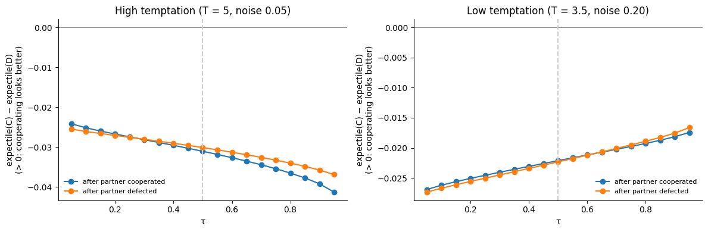<br>
  <sub><b>Figure 8.</b> τ-expectile of the outcomes after cooperating minus after defecting, computed from outcomes experienced in each evolved population. Below zero: defecting looks better.</sub>
</p>

### 5. Populations are unimodal, not mixtures
At T = 5, 100% of evolved agents are optimistic. At T = 3.5 with high noise, 79% are pessimistic.
Optimism comes mainly from a very low α⁻; pessimism from a very high α⁻.

<p align="center">
  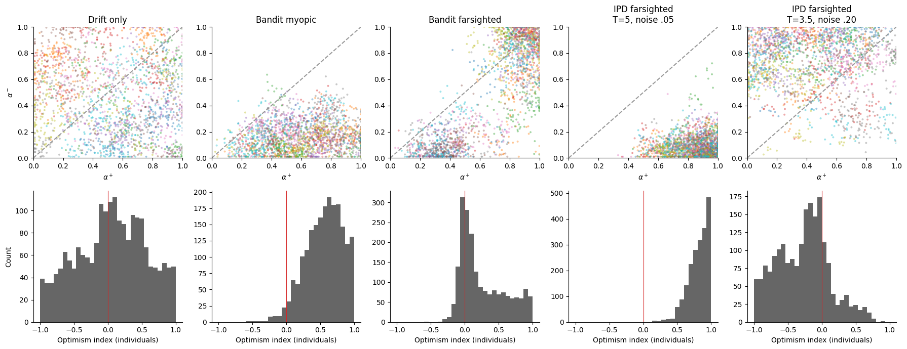<br>
  <sub><b>Figure 9.</b> Final populations pooled across runs: α⁺ against α⁻ (top; colours = runs) and individual optimism indices (bottom).</sub>
</p>

### 6. Controls and cooperation
- A neutral-drift control (random fitness) gives ≈ 0, so the evolved biases reflect selection.
- Cooperation stays moderate and similar across conditions: 39–44% of intended moves and 39–47%
  of realised moves. Shifts in the learning bias do not translate into large differences in
  cooperation.

### 7. What drives the effect: partners, decisiveness and selection
Three further controls, each in a high-temptation world (T = 5, noise 0.05) and a low-temptation
world (T = 3.5, noise 0.20); 10 runs per condition.

**Learning vs non-learning partners.** Same game, payoffs, states and learning rule, three kinds of partner:

| Partner | High temptation | Low temptation |
|---|---|---|
| Random (cooperates 40%, ignores the agent): payoff-matched bandit | +0.81 ± 0.01 | −0.19 ± 0.06 |
| Tit-for-tat (copies the agent's last move) | −0.19 ± 0.05 (α⁺ 0.05, α⁻ 0.10) | +0.25 ± 0.07 |
| Learning partners (original setup) | +0.80 ± 0.02 | −0.34 ± 0.05 |

- **The non-learning random partner reproduces the pattern**, so learning partners are not needed.
- **A responsive partner changes it.** Against tit-for-tat, the future depends on the agent's own
  choice and one-round payoff gaps no longer decide the outcome. At high temptation, evolution
  almost switches learning off (α⁺ ≈ 0.05, α⁻ ≈ 0.10), so the index there mainly reflects tiny
  learning rates rather than pessimism. At low temptation, optimism evolves.
- Learning partners behave like the random partner here, plausibly because exploratory learners
  respond little to the agent's moves.

<p align="center">
  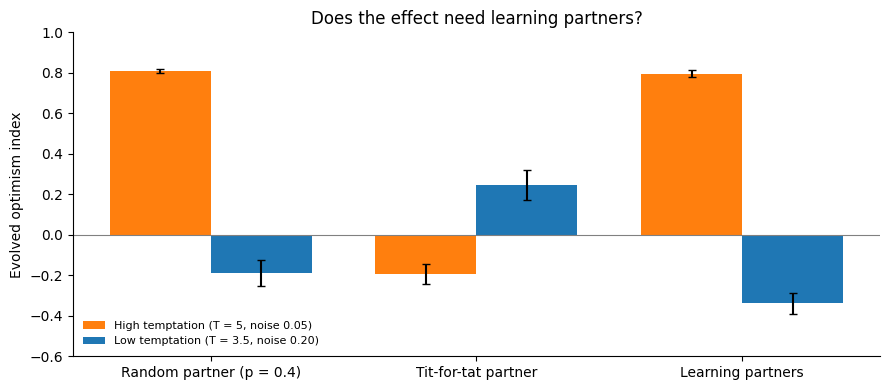<br>
  <sub><b>Figure 10.</b> Evolved optimism index against random, tit-for-tat and learning partners, in the high- and low-temptation worlds. Mean ± SE over 10 runs.</sub>
</p>

**More decisive agents.** With β = 30 and 100 (default β = 10), agents commit to a policy and
cooperation drops to 23–36%.
- High temptation: optimism holds (+0.84, +0.79).
- Low temptation: pessimism shrinks (−0.07, −0.14 vs −0.34 at β = 10).

<p align="center">
  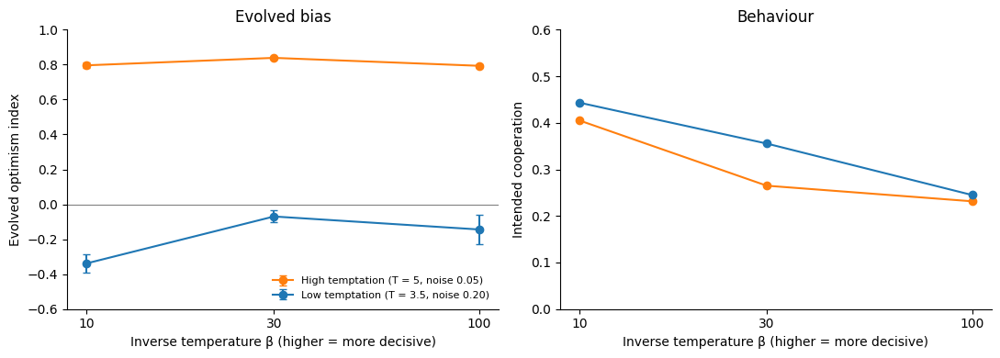<br>
  <sub><b>Figure 11.</b> Evolved optimism index (left) and intended cooperation (right) as agents become more decisive.</sub>
</p>

**Fitness-proportional selection.** With rank-based selection, a tiny payoff edge counts as much as a
large one. Under fitness-proportional selection, where tiny edges give tiny advantages:
- High temptation: +0.29 ± 0.06.
- Low temptation: −0.10 ± 0.09.
- Neutral drift under the same rule: +0.14 ± 0.06.

The directions survive, but only about two standard errors from drift. The large effect sizes
reported above therefore owe much to rank-based selection amplifying small payoff differences.

<p align="center">
  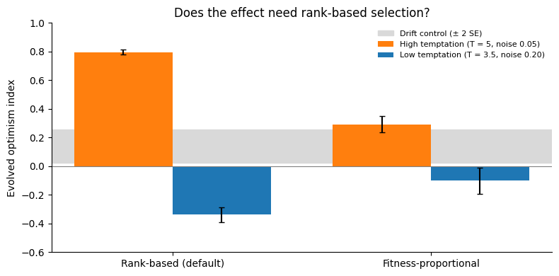<br>
  <sub><b>Figure 12.</b> Evolved optimism index under rank-based vs fitness-proportional selection; the grey band is neutral drift under proportional selection (± 2 SE).</sub>
</p>

## Model
- **Game:** IPD with T ∈ {3.5, 4, 5, 5.5}, R = 3, P = 1, S = 0, divided by T (min–max scaling to
  [0, 1]; a fixed divisor is used as a check), with action noise (each move flipped with probability ε).
  All T values satisfy T > R > P > S and 2R > T + S.
- **Agents:**
  - Tabular Q-learning; state = partner's last move (a separate "no history" state on the first
    round with each partner). Q-values are reset for each new partner.
  - Softmax choice (β = 10), applied to (1−γ)·Q so that choice noise is comparable across γ.
  - Starting values 0.5/(1−γ).
  - Separate learning rates α⁺ and α⁻ for positive and negative prediction errors.
- **Evolution:**
  - 100 agents per generation; fitness = mean payoff (4 random partners × 100 rounds).
  - Rank-based Wright–Fisher selection; offspring inherit (α⁺, α⁻) + Gaussian mutation (sd = 0.03).
  - Initial α⁺, α⁻ ~ Uniform(0.05, 0.95).
- **Optimism index:** (α⁺ − α⁻) / (α⁺ + α⁻), averaged over the last 30 generations;
  20 independent runs per condition, 10 in section 7 (± values are standard errors across runs).

## Repository
| File | Contents |
|---|---|
| `ipd.py` | Game and asymmetric Q-learning agent |
| `evolution.py` | Vectorised lifetimes (bandit, farsighted bandit, IPD, IPD with non-learning partners, drift control) and evolutionary loop |
| `01_agents_and_sanity_checks.ipynb` | Agents learn; cooperation by agent type |
| `02_evolution.ipynb` | Bandit replication vs IPD extension |
| `03_robustness_and_controls.ipynb` | Noise × temptation sweep; controls; starting-value sensitivity; original vs corrected settings; payoff scaling × β; learning-rate distributions |
| `mechanism.py` | Expectiles and invasion analysis (test agents with chosen τ against an evolved population) |
| `04_mechanism_expectiles.ipynb` | Why temptation changes which bias evolves: expectiles, fitness landscapes |
| `05_additional_controls.ipynb` | Non-learning partners (payoff-matched bandit, tit-for-tat), more decisive agents, fitness-proportional selection |

Each notebook is self-contained, so it runs in Google Colab without uploading other files.
All numbers and figures are shown in the executed notebooks; running them also writes the results
as CSV files to `results/`.

## Note on a methodological correction
My first version of this project reported the opposite headline: optimism evolved in the
bandit but **reversed into pessimism** in the IPD, more strongly with more noise. Before
sharing it, I audited the code and found two methodological issues in the farsighted
(γ = 0.9) IPD condition:

1. **Starting values were far too low.** Agents started with values of 0.5, while the true
   values with γ = 0.9 are roughly 2–6. As a result, about 85% of early prediction errors were
   positive, which distorted which bias paid off.
2. **Choice noise was not matched across conditions.** In the farsighted bandit control, I
   rescaled values by (1−γ) before the softmax, but not in the IPD. IPD agents therefore picked
   their top option about 99% of the time, so the IPD differed from the controls in two ways, not one.

The pessimism result needed both issues together: fixing either one alone restores optimism
(section 4 of `03_robustness_and_controls.ipynb`). I corrected both throughout, added a
neutral-drift control and a starting-value sensitivity analysis, and re-ran every analysis.
The results above are from the corrected model.

## Limitations and next steps
- Simple agents (one-move memory) and small populations (100 agents).
- The effect is driven by payoff structure, not by partners being learners (section 7), so this
  is not evidence for anything specifically multi-agent about the bias.
- By default agents choose fairly exploratorily (β = 10 on values scaled to [0, 1]; ≈ 40–46%
  cooperation everywhere), so learning biases shift behaviour by only a few percentage points
  and fitness differences between biases are small.
- Effect sizes depend strongly on the selection rule: under fitness-proportional selection they
  are about two standard errors from drift. The directions are robust; the magnitudes are not.
- The low-temptation pessimism shrinks with more decisive agents.
- Section 7 uses 10 runs per condition; the other sections use 20.
- Hoxha et al. (2025) compare **two** routes to choice hysteresis: positivity bias and gradual
  perseveration (a tendency to repeat past choices). This project models only the first;
  adding an evolving perseveration parameter is the natural next step.
- The mechanism analysis uses the outcomes experienced by unbiased test agents and one-round
  payoff gaps as an intuition; it is not a full equilibrium analysis.
- Conceptual replication only: settings are not matched exactly to Hoxha et al. (2025).
- Next steps:
  - run fitness-proportional selection for many more generations, to see whether the directions
    firm up under weak selection;
  - study responsive partners (tit-for-tat, generous tit-for-tat, more decisive learners) in their
    own right, since responsiveness changes which bias evolves;
  - test the T = 4 threshold prediction directly, with a finer grid of T values around 4 and other
    payoff matrices where the two gaps cross elsewhere;
  - add gradual perseveration and compare it with positivity bias in the IPD, as in Hoxha et al. (2025);
  - richer strategies and memory;
  - fit the same α⁺/α⁻ model to human or LLM play in social dilemmas.

## References
- Hoxha, I., Sperber, L., & Palminteri, S. (2025). Evolving choice hysteresis in
  reinforcement learning: comparing the adaptive value of positivity bias and gradual
  perseveration. *PNAS*.
- Lefebvre, G., Lebreton, M., Meyniel, F., Bourgeois-Gironde, S., & Palminteri, S. (2017).
  Behavioural and neural characterization of optimistic reinforcement learning.
  *Nature Human Behaviour*.
- Palminteri, S., & Lebreton, M. (2022). The computational roots of positivity and
  confirmation biases in reinforcement learning. *Trends in Cognitive Sciences*.

## Run
```
pip install numpy pandas matplotlib
# open the notebooks in order (01 -> 05); notebook 03 takes ~1 hour, notebook 05 ~40 min
```
